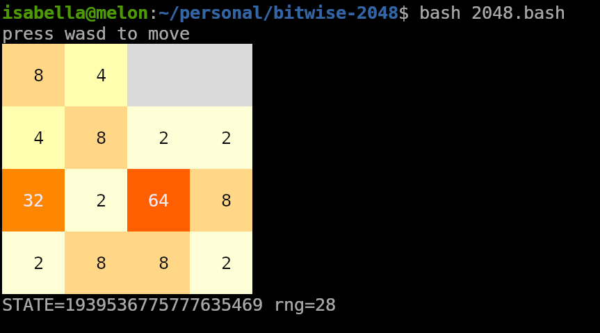

# [The Bitwise Challenge: 2048]

This is an implementation of the classic 2048 game in your terminal:


Share your game state with friends by just sending them a number!

If the `$STATE` env variable isn't set, it generates a fresh random seed.

Otherwise the board state and all future spawned cells will be deterministic.


### Run the development server

```bash
bash 2048.bash
```